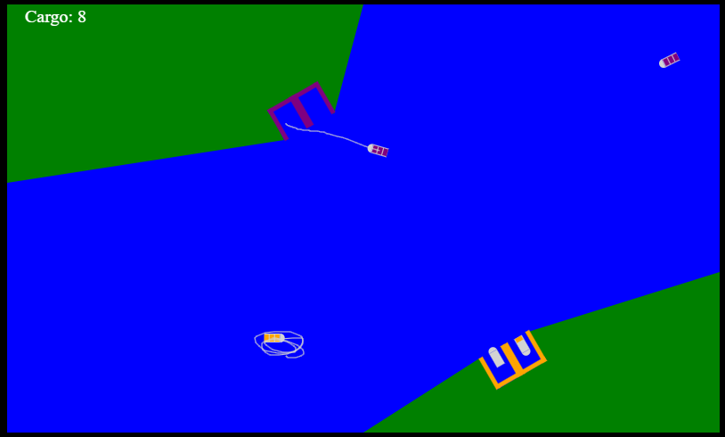

# Boat-Control

Boat Control is a line-drawing game that can fit in an under 3kb file when built. it is an homage to Harbor Master by Imangi Studios.

## How to Play

- Drag boats to docks
- Drag them back off-screen when they unload
- Don't Crash!

## Compression

Boat Control is compressed to fit under 3kb. It is compressed using Node zlib deflate-raw, which is saved as base64. A decompression script is attached to it and inserted into the html when building.

## How to build

```
git clone https://github.com/greywolfcode/Boat-Control
cd Boat-Control
npm install
node run build
```

## Licence

Boat Control is licensed under the MIT Licence. Boat Control is not affiliated with Imangi Studios.
